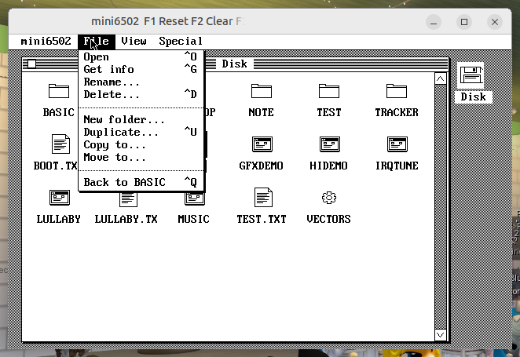
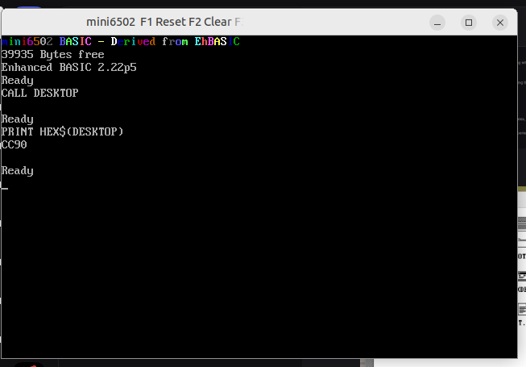

# mini6502 — A fantasy 8-bit computer for retro enthusiasts

**mini6502** is a fantasy 8-bit computer written in [QB64 Phoenix Edition](https://github.com/QB64-Phoenix-Edition/QB64pe). It brings the charm of retro computing with imaginative hardware, a custom BASIC environment derived from EhBASIC, and a full desktop environment.

## Features

- **CPU**: Fake6502 translation (public domain), the 6502 emulation core
- **RAM**: 1 MB of banked memory with a consistent 8-bit retro vibe
- **ROM Monitor**: A custom ROM monitor providing immediate boot and system control
- **BASIC Engine**: Derived from [EhBASIC](https://github.com/Klaus2m5/6502_EhBASIC_V2.22) by Lee Davison (see license below)
- **Desktop Environment**: A GEOS/AppleFinder-inspired desktop with menus, windows, dialogs, and file management

## License & Attribution ⚠️ Important Note

> **EhBASIC Derivative Status**  
> mini6502 BASIC is a derivative of [EhBASIC](https://github.com/Klaus2m5/6502_EhBASIC_V2.22) written by the late Lee Davison (1978–2024). Because he has passed away, **permission for commercial use cannot currently be granted by his estate**. This project is licensed under EhBASIC's terms: free for personal, non-commercial use only.
>
> For commercial applications involving the BASIC engine or its extensions, you must seek permission from Lee Davison's legal estate (contact: `leeedavision@gmail.com`).

The rest of mini6502 (the host code, monitor ROM, toolkit, desktop, editor, music engine, demos, hw tools) is under the **GNU GPL v3**. The 6502 core is in the public domain.

## Getting Started

### Building with QB64 Phoenix Edition

Prerequiste:
- QB64 Phoenix Edition
- Python (for generatives script)
- cc65/ca65 for building the 6502 assembly sources (prebuilt ready to run 6502 software exist in disk subdirectory for convenience)

mini6502 is codded in [QB64 Phoenix Edition](https://github.com/QB64-Phoenix-Edition/QB64pe), a modern structured version of QuickBasic featuring an integrated IDE/TUI similar to QBasic.

**To build and run:**
1. Open QB64 Phoenix Edition
2. Load `mini6502.bas`
3. go to menu Run, Select Start (F5) to run it from the IDE or Make an Executable (F11) to just produce the executable.
4. binary for the emulator are build from assembly source with ca65 (prebuit provided for convenince in disk subdirectory which is the disk provided by the host to the emulator)
5. The project's Python scripts assist with building, generating configuration files, and preparing assets for the emulator

### Booting & Loading Programs

- At boot the monitor look for a binary BOOT file in disk that is loaded and executed (autoboot) or a BOOT.TXT as non conditional autotyped script
- L load a binary from the monitor (6502 little endian address prefixed) overidable if you provide the hexadecimal address yourself and optionaly a bank number if loaded at $E000
- T load an autotyped non conditional script

From the desktop: double-click icons files. basic files while drop back to basic, text file while open the notepad, .PIC files while open the Paint etc...

### Using BASIC Extensions (`!`)

The extension wedge adds commands via the `!` prefix. Examples:

```basic
10 !SCREEN 1:!CLG 0                    ' lowres mode (160 × 200),Clear graphic screen
20 !COLOR 15                           ' set colour index (0–31 + DIM)
30 FOR I=0 TO 159 STEP 4
40     !LINE 80,100,I,0                ' draw a line from (80,100) to (I,0)
50 NEXT
60 !WAIT 120                           ' wait for 2 seconds
70 !SCREEN 0                           ' back to text mode 
```

See `basicx/README.txt` for the complete extension reference.

## Project Structure

### 📂 basic/ — EhBASIC Engine
- Extended BASIC 2.22p5 adapted for mini6502
- Build scripts, documentation, and the reference manual

### 📂 basicx/ — BASIC Extensions
- The `!` extension wedge providing graphics, sound, mouse input
- Includes `GFX` (graphics/sound/mouse), `BX` (extra commands), and more

### 📂 asm/ — Native 6502 Assembler
- Banked full-screen source editor based on EDIT
- Ctrl+A assembles source inside mini6502 and saves loadable binaries
- All official NMOS 6502 opcodes, labels, expressions, and data directives
- See [asm/README.md](asm/README.md) for startup, syntax, and limits

### 📂 toolkit/ — Desktop Toolkit
- Windows, menus, dialogs, file dialog for hires mode
- Modules TK1–TK5 split across memory banks ($10–$19)
- Entry points defined in `VCTORS` (far-call table)

### 📂 desktop/ — Desktop Environment
- GEOS/AppleFinder-inspired interface files

### 📂 demos/ — Demonstration Programs
- **breakout/** — Classic breakout game in Asm 
- **gfx/** — Graphics demo (`GFXDEMO`) with sprite support
- ** hires/** — Hires-mode graphics demonstration
- **irq/** — Interrupt handling test program
- **lullaby/** — Plays Brahms' *Lullaby* (1868)

### 📂 pixel/ — Pixel Editor
- Full-screen colour pixel editor for pictures and sprites
- Supports 160 × 200 pixels in 31 colours with transparency

### 🎵 music/ — Music Engine
- Background music player using the three voice voices of the frame interrupt
- The noise voice (voice 4) remains available for sound effects during playback
- Demo: Brahms' *Lullaby* (public domain composition)

### 📂 hw/ — Hardware Simulation Tools
- Register definitions, assembler utilities, vectors table
- Python generators (`gen.py`, `check.py`) for creating emulator files

## Development Guide

### Extending the BASIC Extensions (`basicx/`)

1. Add handler functions to appropriate modules (e.g., `bxinc.inc`)
2. Register the command with its mnemonic in the extension wedge
3. Document the new commands in `basicx/README.txt`

### Adding New Demos

Demo programs follow this pattern:
1. Write BASIC or assembly source files
2. Assemble using `build.sh` to produce `.bin`, `.cfg`, and `.hex` files
3. Place them in a subdirectory under `demos/`

### Contributing to the Toolkit

Toolkit modules are split across memory banks for organization:
- **TK1** — Desktop windows, menus, dialogs (banks $10–$11)
- **TK2** — Controls and file dialog (bank $17–$18)
- **TK3/TK4/TK5** — Additional toolkit components (banks $1A–$19)

### Screenshots



## License Summary

| Component | License | Notes |
|-----------|---------|-------|
| **mini6502 core** (`fake6502.bi`, `fake6502.bm`) | Public domain | Based on Fake6502 by Mike Chambers |
| **mini6502 host code, monitor ROM, toolkit, desktop, editor, music engine, demos, hw tools** | GPL v3 | Free software under the Free Software Foundation license |
| **BASIC Engine + Extensions** (`basic/`, `basicx/`) | EhBASIC (custom) | Personal, non-commercial use only. Commercial use requires estate permission |

## Acknowledgments

- **Lee Davison** — for EhBASIC, the foundation of our BASIC engine
- **Klaus Dormann** — for bug-fix patches to EhBASIC 2.22p5
- **Mike Chambers** — for Fake6502 (public domain core)
- **Claude AI** — as a collaborative coding assistant throughout this project

---

*© 2026 Benoit Colson.*  
*This software is free software; you can redistribute it and/or modify it under the terms of the GNU General Public License as published by the Free Software Foundation, either version 3 of the License, or (at your option) any later version. It is distributed WITHOUT ANY WARRANTY; without even the implied warranty of MERCHANTABILITY or FITNESS FOR A PARTICULAR PURPOSE.*
